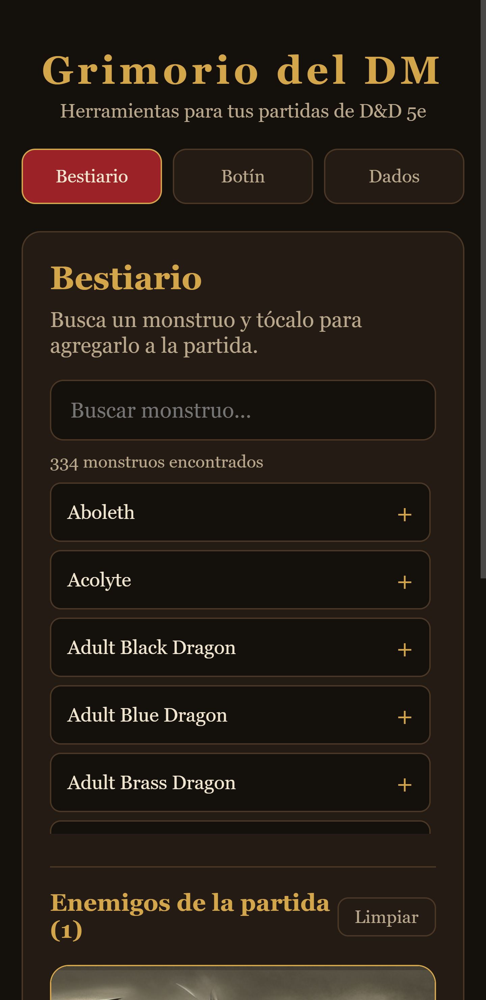
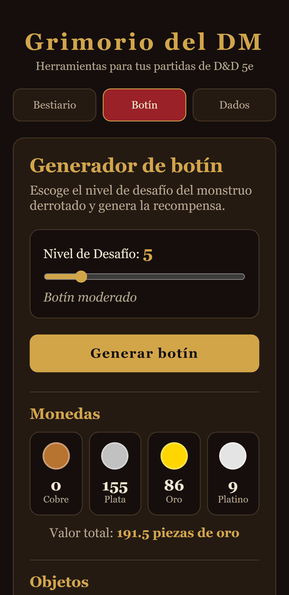
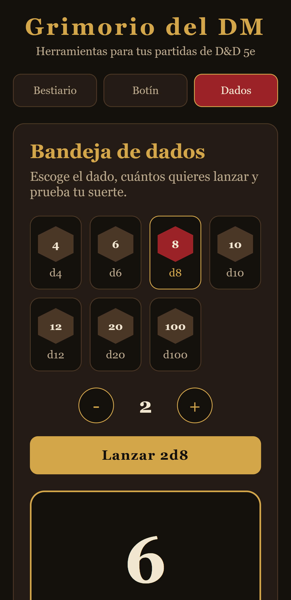
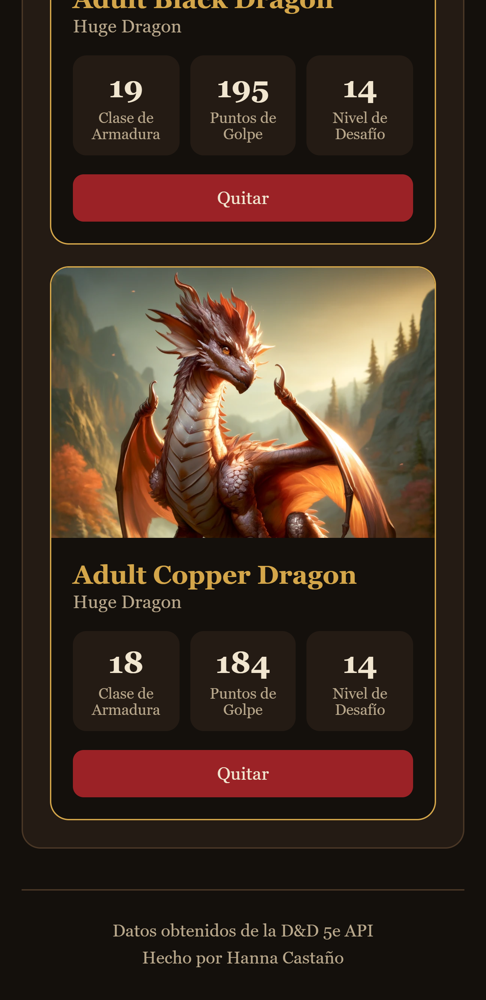
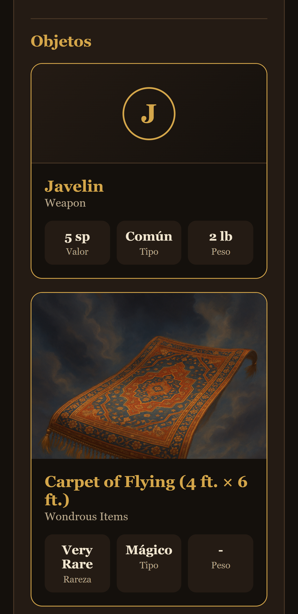
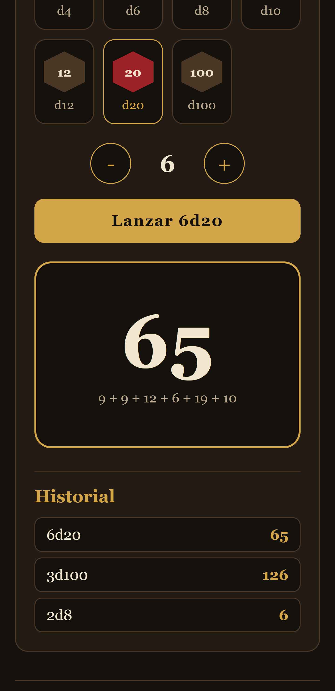
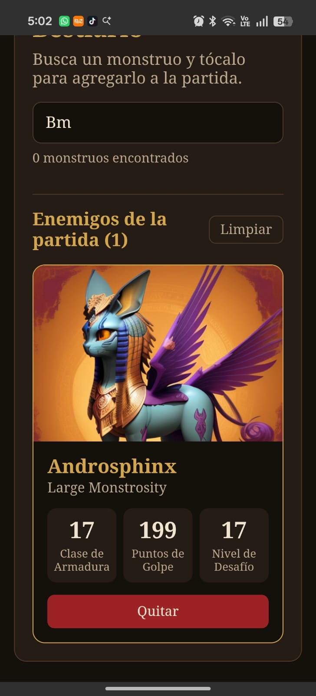
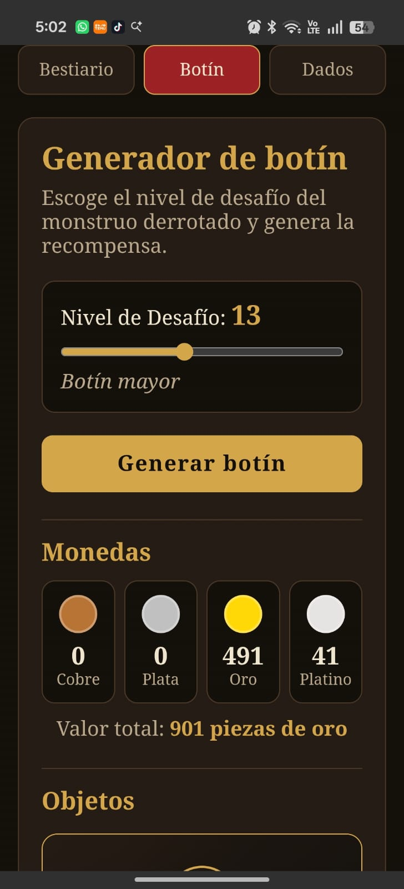
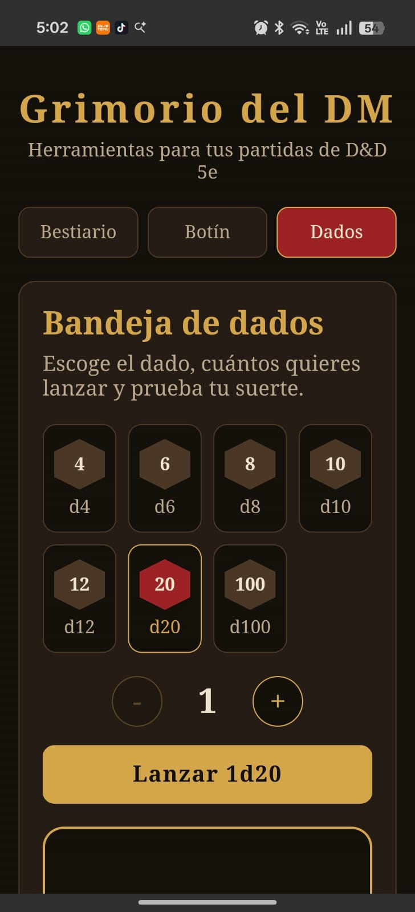

# Grimorio del DM

Herramienta interactiva para asistir a un Dungeon Master durante sus partidas de Dungeons & Dragons 5e. Funciona en el navegador con diseño responsivo y como aplicación Android.

## Enlaces

- **Aplicación web (Vercel):** https://grimorio-dm.vercel.app/
- **Descargar APK (GitHub Releases):** https://github.com/gabycastb-prog/grimorio-dm/releases/tag/v1.0.0

## Módulos

### Bestiario y enemigos de partida
- Consulta la lista completa de monstruos desde `/api/monsters`.
- Buscador para filtrar enemigos por nombre.
- Al tocar un monstruo se consulta su detalle y se agrega a los enemigos de la partida.
- Cada enemigo se muestra en una tarjeta reutilizable con imagen, Clase de Armadura, Puntos de Golpe y Nivel de Desafío.

### Generador de botín
- Deslizador para escoger el Nivel de Desafío del monstruo derrotado (0 a 30).
- El nivel se agrupa en cuatro rangos (menor, moderado, mayor y legendario) que definen la cantidad de monedas y de objetos.
- Monedas aleatorias de cobre, plata, oro y platino, con el cálculo de su valor total en oro.
- Objetos reales consultados desde `/api/equipment` y `/api/magic-items`. Los niveles altos entregan más objetos mágicos.

### Bandeja de dados
- Dados d4, d6, d8, d10, d12, d20 y d100.
- Lanzamiento de 1 a 10 dados del mismo tipo con el total y cada tirada.
- Resultado destacado con animación, aviso de crítico y pifia en el d20, e historial de las últimas tiradas.

## Tecnologías

- React
- Vite
- JavaScript
- CSS (enfoque Mobile-First)
- Fetch para consumir la [D&D 5e API](https://www.dnd5eapi.co/api/)
- Git y GitHub (ramas, commits y Releases)
- Vercel (despliegue continuo)
- CapacitorJS y Android Studio (empaquetado Android)

## Estructura del proyecto

```
src/
├── App.jsx
├── App.css
├── index.css
├── main.jsx
├── components/
│   ├── Navegacion.jsx
│   ├── Tarjeta.jsx
│   ├── Estadistica.jsx
│   ├── Moneda.jsx
│   └── BotonDado.jsx
├── secciones/
│   ├── Bestiario.jsx
│   ├── Loot.jsx
│   └── Dados.jsx
├── services/
│   └── dndApi.js
└── utils/
    ├── botin.js
    └── formato.js
android/                Proyecto Android generado con Capacitor
capacitor.config.json   Configuración de Capacitor
```

## Instalación y ejecución

### Requisitos
- Node.js y npm
- Android Studio (solo para generar el APK)

### Ejecutar en el navegador
```
git clone https://github.com/gabycastb-prog/grimorio-dm.git
cd grimorio-dm
npm install
npm run dev
```

### Generar el APK
```
npm run build
npx cap sync android
npx cap open android
```
En Android Studio: **Build > Generate App Bundles or APKs > Generate APKs**.

## Manual de uso

1. **Bestiario:** escribe en el buscador, toca un monstruo para agregarlo a la partida y usa Quitar o Limpiar para manejar los enemigos.
2. **Botín:** mueve el deslizador al nivel del monstruo derrotado y presiona Generar botín.
3. **Dados:** escoge el dado, la cantidad con los botones menos y más, y presiona Lanzar.

## Capturas

### Web (modo celular)

| Bestiario | Botín | Dados |
| --- | --- | --- |
|  |  |  |
|  |  |  |

### En Android

| Captura 1 | Captura 2 | Captura 3 |
| --- | --- | --- |
|  |  |  |

### En Android


## Historial de desarrollo

El proyecto se trabajó por ramas, una por cada módulo, unidas a `main`:
`bestiario`, `loot`, `dados`, `diseno`, `capacitor` y `documentacion`.

## Créditos

Datos de monstruos, equipo y objetos mágicos: [D&D 5e API](https://www.dnd5eapi.co/).

## Autora

Hanna Gabriela Castaño Beltrán